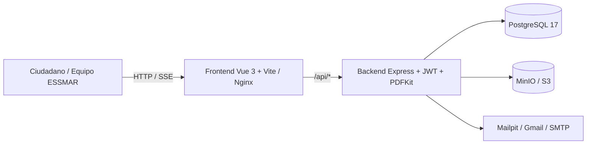
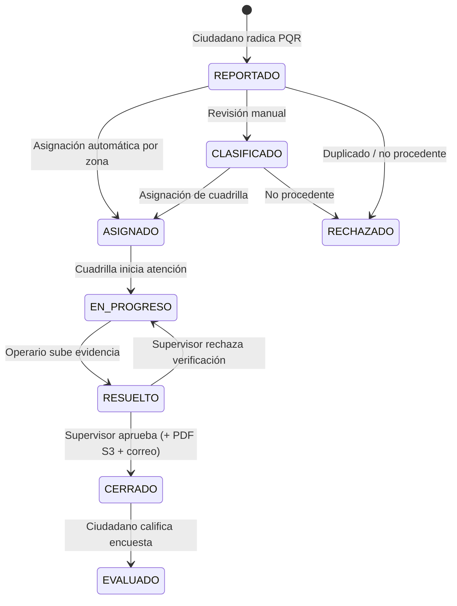

# ESSMAR SIGVI

Plataforma web para radicación de reportes ciudadanos (PQR), asignación automática de cuadrillas, carga de evidencias en campo, verificación de cierre, generación documental PDF en almacenamiento S3 e indicadores de cumplimiento SLA para Santa Marta.

---

## Arquitectura general



| Componente | Stack | Puerto local |
|---|---|---|
| **Frontend** | Vue 3, TypeScript, Vite, Pinia, Leaflet, Chart.js | `5173` (dev) / `8080` (Docker) |
| **Backend API + SSE** | Node.js 20+, Express, JWT, `scrypt`, `pdfkit`, `nodemailer` | `3001` |
| **Base de datos** | PostgreSQL 17 (10 tablas, 5 triggers, 4 vistas SLA) | `5432` |
| **Object Storage (S3)** | MinIO local (compatible con AWS S3 / Cloudflare R2) | `9000` (API) / `9001` (Consola) |
| **Correo electrónico** | Mailpit local (dev) o Gmail / OAuth2 / SMTP corporativo | `1025` (SMTP) / `8025` (Web UI) |

---

## Arranque rápido (Windows, macOS y Linux)

### Opción 1 — Desarrollo local en un solo comando (recomendado)

Requisitos: **Node.js 20+** y **Docker Desktop** (Windows/macOS) o **Podman / Docker** (Linux).

```bash
git clone https://github.com/Yizus-2/proyectoF.git
cd proyectoF
npm run up
```

`npm run up` ejecuta el orquestador multiplataforma (`scripts/cli.mjs`), que automáticamente:
1. Crea `.env` con un `JWT_SECRET` aleatorio si no existe.
2. Instala `node_modules` en la raíz y en `server/` solo si faltan.
3. Detecta **Docker** o **Podman** (con o sin `compose`) y levanta PostgreSQL 17, MinIO S3 y Mailpit.
4. Espera a que la infraestructura responda, inicia la API (`:3001`) y Vite (`:5173`) e imprime URLs y credenciales.

### Opción 2 — Despliegue 100% en contenedores (sin Node en el host)

```bash
cp .env.example .env
docker compose --profile full up -d --build
# o con Podman:
podman compose --profile full up -d --build
```

La aplicación queda servida en **http://127.0.0.1:8080** mediante Nginx (`nginx.conf`) con proxy inverso hacia `/api/` compatible con Server-Sent Events (SSE).

---

## Comandos disponibles

| Comando | Descripción |
|---|---|
| `npm run up` | Prepara `.env`, dependencias, contenedores, API y frontend |
| `npm run doctor` | Diagnostica SO, Docker/Podman, `.env`, dependencias y salud de los 5 servicios |
| `npm run setup` | Solo genera `.env` e instala dependencias sin levantar servidores |
| `npm run infra:up` | Levanta únicamente PostgreSQL 17, MinIO S3 y Mailpit |
| `npm run infra:down` | Detiene los contenedores conservando los volúmenes de datos |
| `npm run infra:reset` | Elimina contenedores y volúmenes para reiniciar desde cero |
| `npm run build` | Valida tipos (`vue-tsc -b`) y genera el bundle de producción (`vite build`) |

---

## Roles, rutas y cuentas iniciales

### Rutas de la aplicación

| Ruta | Acceso | Función |
|---|---|---|
| `/` | Público | Inicio y accesos rápidos |
| `/reportar` | Público | Radicación ciudadana con mapa GPS y foto inicial |
| `/rastrear` | Público (excepto admin) | Consulta por código PQR, historial y descarga de comprobante PDF |
| `/encuesta/:code` | Público | Calificación ciudadana del servicio tras cierre |
| `/login` | Público | Inicio de sesión interno |
| `/gestion` | `operator`, `supervisor`, `admin` | Bandeja operativa, cambio de estado y evidencias de campo |
| `/indicadores` | `supervisor`, `admin` | Tablero SLA, mapas, verificación de cierres y exportación PDF/CSV |
| `/operarios` | `admin` | Administración de operarios y asignación de zonas/cuadrillas |

### Cuentas semilla (desarrollo local)

Se crean automáticamente al arrancar la API (personalizables en `.env`):

| Rol | Correo | Contraseña por defecto |
|---|---|---|
| **Administrador** | `admin@essmar.gov.co` | `AdminEssmar2026!` |
| **Supervisor** | `supervisor@essmar.gov.co` | `SupervisorEssmar2026!` |
| **Operarios (1–10)** | `operador1@essmar.co` … `operador10@essmar.co` | `OperarioEssmar2026!` |

---

## Ciclo de vida de un reporte PQR



---

## Estructura del repositorio

```text
proyectoF/
├── db/init/                  # Esquema unificado PostgreSQL 17 y datos semilla
│   ├── 01_schema.sql
│   └── 02_seed.sql
├── docs/                     # Documentación técnica detallada
│   ├── ARQUITECTURA_Y_BD.md
│   ├── API.md
│   └── CORREO_Y_DESPLIEGUE.md
├── scripts/
│   └── cli.mjs               # Orquestador multiplataforma (up, doctor, setup, infra)
├── server/                   # Backend Express + PostgreSQL + S3 + PDF + SMTP
│   ├── Dockerfile
│   └── src/
│       ├── index.js          # Rutas REST, SSE, RBAC y middlewares de seguridad
│       ├── db.js             # Pool pg con parsers numéricos BIGINT/NUMERIC
│       ├── auth.js           # Hash scrypt y tokens JWT
│       ├── storage.js        # Cliente S3 (MinIO / AWS S3 / R2)
│       ├── pdf.js            # Generador de comprobante PQR e informe ejecutivo
│       ├── mailer.js         # Mailpit, Gmail App Password, OAuth2 y SMTP
│       ├── events.js         # Emisor SSE en tiempo real
│       └── seed.js           # Semilla idempotente de usuarios y cuadrillas
├── src/                      # Frontend Vue 3 + TypeScript + Pinia
│   ├── components/
│   ├── composables/
│   ├── lib/api.ts
│   ├── router/index.ts
│   ├── stores/
│   ├── types/
│   └── views/
├── Dockerfile                # Build multi-etapa Vue + Nginx
├── docker-compose.yml        # Infra base + perfil "full"
├── nginx.conf                # SPA + reverse proxy /api/ con soporte SSE
└── .env.example              # Plantilla de variables de entorno
```

---

## Documentación técnica

- [Arquitectura, Base de Datos, S3 y Seguridad](docs/ARQUITECTURA_Y_BD.md)
- [Referencia de la API REST y SSE](docs/API.md)
- [Configuración de Correo (Mailpit / Gmail) y Despliegue por SO](docs/CORREO_Y_DESPLIEGUE.md)
